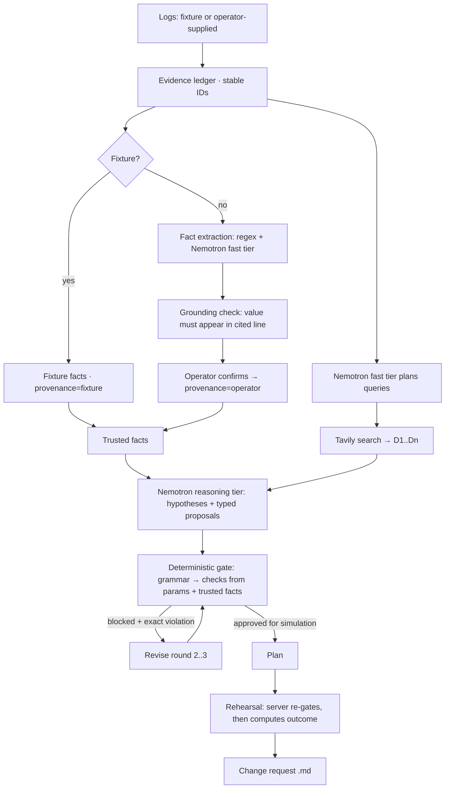

# RehearseOps architecture

**The model proposes; code decides; the simulator only rehearses what code approved.**

## Trust boundaries

1. **Model output is untrusted input.** Proposals go through `validateProposal`: the type must be in the grammar, params must exactly match the schema (no extra keys, integers in range, enums, safe identifier patterns). Evidence and citation IDs that don't exist are dropped.
2. **Checks are derived, not declared.** `deriveChecks(type, params, facts)` computes e.g. `replicas × poolSize + otherConnections ≤ maxConnections` from the proposal's own parameter. No action carries a hand-written "checks" list.
3. **Facts need provenance.** The gate reads only `confirmed` facts (`trusted()`); a missing fact means deny. Fixture facts are confirmed fixture data; model-extracted facts stay candidates until an operator confirms them. For fixture scenarios the server ignores any client-sent facts.
4. **Logs and web pages can't give orders.** Both are passed as data. The live injection test checks this, and the adversarial suite checks the gate holds even if the model complies.
5. **Rehearsal re-gates.** `/api/rehearse` runs the gate again on the server; blocked ⇒ HTTP 409, no simulation.
6. **Credentials stay server-side**, and a per-hour model budget protects credits on a public demo.

## Model usage

| Call | Tier | Default model | When |
|---|---|---|---|
| Fact extraction + search queries | fast | Nemotron 3 Nano | custom logs |
| Search-query planning | fast | Nemotron 3 Nano | fixture scenarios, when Tavily is configured |
| Investigate + propose | reasoning | Nemotron 3 Ultra | round 1 |
| Revise after gate feedback | reasoning | Nemotron 3 Ultra | rounds 2–3, only when something was blocked |
| Probe | both | — | Integrations → Verify live call |

The client sends `response_format: json_object` and retries without it if the model rejects it; strips `<think>` blocks; retries once on 429/5xx; and auto-resolves a missing model ID from `/v1/models`.
